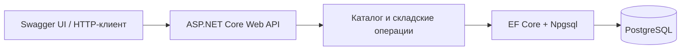

# Архитектура

Предлагается один проект ASP.NET Core Web API на .NET 10, один экземпляр PostgreSQL и один тестовый проект xUnit. HTTP-слой принимает запросы, проверяет форму данных и возвращает ответы. Складские операции содержат бизнес-правила и управляют транзакциями. Для обычных запросов и миграций используется EF Core с провайдером Npgsql. OpenAPI описывает API, Swagger UI даёт локальный интерфейс для пробных запросов.

Проекты будущего решения — `src/MarketFlow.Api` и `tests/MarketFlow.Tests`. Внутри API достаточно обычных классов по назначению. Отдельные проекты слоёв, общий repository и шина команд не нужны. Одна база позволяет зафиксировать операцию, остаток и историю одной транзакцией. Точный формат ответов задаёт [спецификация](specs/mvp.md).

## Данные и конкурентные записи

- `Stock` имеет составной ключ `(productId, warehouseId)`, внешние ключи и ограничение `CHECK (reserved >= 0 AND on_hand >= reserved)`. Храним физическое и зарезервированное количество. Доступное вычисляем при чтении. Уникальные ограничения защищают SKU и нормализованный номер поставки. Внешние ключи сохраняют ссылки операций. История содержит ровно одну ссылку на операцию соответствующего типа, с уникальностью этой ссылки.
- **Приёмка.** В транзакции `READ COMMITTED` вставить факт поставки с `ON CONFLICT (reference) DO NOTHING`. Если вставка пропущена, отдельным запросом прочитать зафиксированную строку и сравнить товар, склад и количество. Если вставка прошла, атомарно создать строку остатка или прибавить количество через `INSERT … ON CONFLICT … DO UPDATE` по паре. Для существующего остатка условие `on_hand <= max - quantity` защищает от переполнения. Ноль изменённых строк означает `stock_limit` и откат всей приёмки. Добавить запись истории и зафиксировать транзакцию.
- **Резерв.** В транзакции проверить существование товара и склада. Увеличить `reserved` одной атомарной командой `UPDATE` по паре с условием `on_hand - reserved >= quantity`. Если изменено ноль строк, вернуть `insufficient_stock`. После успешного обновления записать резерв и историю, затем зафиксировать всё вместе.
- Для новой поставки ссылочную целостность защищают внешние ключи. Именованные ограничения дают возможность отличить неизвестный товар или склад от непредвиденного сбоя. Обрабатывать надо конкретные ожидаемые конфликты, сохраняя исходную ошибку в серверных логах для остальных случаев.
- Складские команды выполняются с параметрами через то же подключение и транзакцию EF Core, что запись журнала. Проверка остатка отдельным чтением перед безусловным сохранением допускает гонку. PostgreSQL при `READ COMMITTED` ждёт конкурирующую запись и повторно проверяет условие обновления. Для пропущенной вставки поставки следующий запрос получает новый снимок и видит запись победителя. [Изоляция PostgreSQL](https://www.postgresql.org/docs/current/transaction-iso.html) · [INSERT и ON CONFLICT](https://www.postgresql.org/docs/current/sql-insert.html) · [Транзакции EF Core](https://learn.microsoft.com/en-us/ef/core/saving/transactions).

## Запуск

Цель для Compose — контейнер API и контейнер PostgreSQL с томом. API публикуется на локальном интерфейсе, БД доступна внутри сети Compose. При запуске локального стенда один экземпляр API применяет миграции после готовности БД. Параметры подключения поступают из окружения, пример содержит только демонстрационные значения. GitHub Actions запускает сборку и тесты на Linux с настоящим PostgreSQL.

План рассчитан на локальную демонстрацию. Многопользовательские права, публичный хостинг и отдельный процесс выкладки миграций понадобятся только при согласованном расширении сценария.
